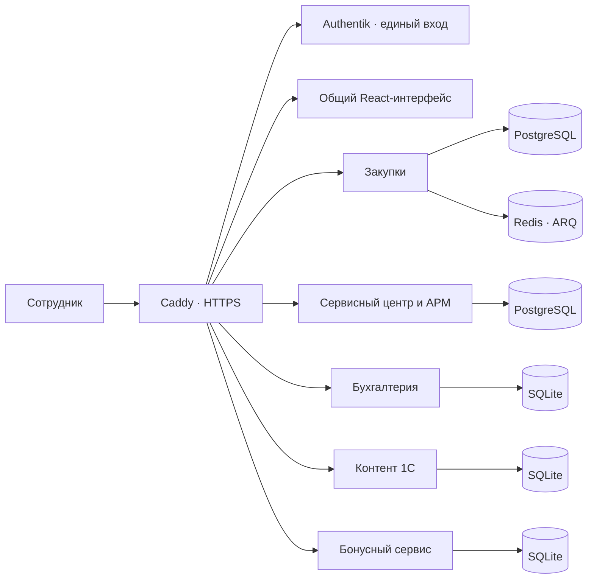

# ScantechDesk — корпоративный портал «Рабочее место»

Единый интерфейс для закупок, сервисного центра и АРМ, бухгалтерии,
контента 1С и бонусной программы MEFERI.

Портал использует модульную сервисную архитектуру: общий React-фронтенд,
отдельные Python/FastAPI-бэкенды и единый вход через Authentik.
Каждый бизнес-сервис имеет собственное хранилище данных и обновляется отдельно.
Фронтенд выпускается одной общей сборкой.

## Общий фронтенд

| Технология | Назначение |
|---|---|
| React 19 | Компоненты и интерфейс всех разделов |
| TypeScript 7 | Типизация фронтенда |
| Vite 8 | Локальная разработка и production-сборка |
| React Router 7 | Страницы и переходы между разделами |
| Tailwind CSS 4 | Стили и адаптивная вёрстка |
| shadcn/ui, Radix UI, UI SDK | Кнопки, формы, меню, диалоги и другие компоненты |
| Lucide React | Иконки |
| date-fns, React Day Picker | Даты и календарь |

## Бэкенды и хранение данных

| Раздел | Бэкенд | Хранение данных | Особенности |
|---|---|---|---|
| Закупки · KPRorders | Python 3.13, FastAPI, Uvicorn | PostgreSQL 17, SQLAlchemy, asyncpg, Alembic | Redis, очередь ARQ, WebSocket и SSE; распознавание заявок, MCP и поиск предложений поставщиков |
| Сервисный центр и АРМ | Python 3.12, FastAPI, Uvicorn | PostgreSQL 16, SQLAlchemy, psycopg, Alembic | Заявки и ремонты, файлы и вложения; отдельный Python-воркер для задач по расписанию |
| Бухгалтерия · Booker | Python 3.12, FastAPI, Uvicorn | SQLite | Диадок, черновики документов в 1С, акты сверки |
| Контент 1С | Python 3.12, FastAPI, Uvicorn | SQLite и файловые каталоги | Обработка Excel, характеристик и фотографий; фоновые задания |
| Бонусный сервис | Python 3.12, FastAPI, Uvicorn | SQLite | Пользователи, каталог, заявки и бонусные операции |

PostgreSQL используется в закупках и сервисном центре. Бухгалтерия, бонусы
и контент 1С используют отдельные SQLite-базы. У Authentik своя база PostgreSQL 17.

## Инфраструктура

| Компонент | Назначение |
|---|---|
| Docker + Docker Compose | Сборка и запуск сервисов на VPS |
| Caddy 2 | HTTPS, выдача фронтенда и маршрутизация API |
| Authentik | Единый вход, пользователи, группы и роли |
| Redis 7 | Очередь и события закупок |
| Docker volumes и серверные каталоги | Базы, вложения и рабочие файлы |
| pg_dump и архивирование | Резервные копии |
| Git + GitHub | Исходники и история изменений |

## Интеграции и обработка данных

| Технология или интеграция | Применение |
|---|---|
| HTTP API, JSON и OData | Обмен между системами; взаимодействие с 1С |
| HTTPX и Requests | HTTP-клиенты для внешних сервисов |
| OpenRouter и OpenAI-совместимый API | Распознавание заявок и обработка данных с помощью языковых моделей |
| MCP `marketplace` | Поиск товаров и предложений поставщиков |
| Playwright + Chromium, BeautifulSoup | Получение данных интернет-магазинов |
| openpyxl | Чтение и формирование Excel |
| Pillow | Обработка изображений в контенте 1С |
| Диадок | Документооборот в бухгалтерском сервисе |
| Яндекс.Диск | Источник фотографий для контента 1С |
| СДЭК и электронная почта | Адаптеры доставки и уведомлений в соответствующих сервисах |

Доступность конкретной внешней интеграции зависит от настроек развёртывания.

## Проверка качества

| Инструмент | Назначение |
|---|---|
| pytest, pytest-asyncio, pytest-cov | Проверки Python-кода, асинхронных сценариев и покрытия |
| Ruff | Проверка и форматирование Python-кода |
| Pyright | Статическая проверка типов в использующих его сервисах |
| Import Linter | Проверка архитектурных границ слоёв в соответствующих проектах |
| TypeScript | Проверка типов фронтенда |
| Vitest и Testing Library | Тесты интерфейса |
| Playwright | Проверка пользовательских сценариев в браузере |

## Репозитории

| Репозиторий | Содержание |
|---|---|
| [scantech-service-template](https://github.com/Scantech-Working-Trio-Org/scantech-service-template) | Общий интерфейс «Рабочее место» |
| [KPRorders](https://github.com/Scantech-Working-Trio-Org/KPRorders) | Закупки и MCP-поиск товаров |
| [Meferi-Portal-SC](https://github.com/Scantech-Working-Trio-Org/Meferi-Portal-SC) | Сервисный центр и АРМ |
| [Booker-service](https://github.com/Scantech-Working-Trio-Org/Booker-service) | Бухгалтерия |
| [Meferi-Retail-Products-1C](https://github.com/Scantech-Working-Trio-Org/Meferi-Retail-Products-1C) | Контент и интеграция с 1С |
| [Meferi-Bonus-Service](https://github.com/Scantech-Working-Trio-Org/Meferi-Bonus-Service) | Бонусная программа |
| [scantech-infrastructure](https://github.com/Scantech-Working-Trio-Org/scantech-infrastructure) | Общий шлюз, Authentik и инфраструктура |
| [VPS-Servers](https://github.com/Scantech-Working-Trio-Org/VPS-Servers) | Эксплуатационная документация |

Описано по репозиториям и проверке контейнеров VPS от **23 ноября 2026 года**.
Точные версии зависимостей и инструкции по запуску находятся в соответствующих репозиториях.
